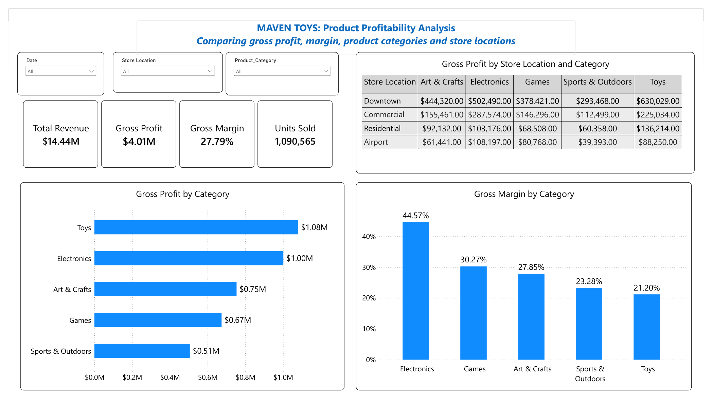
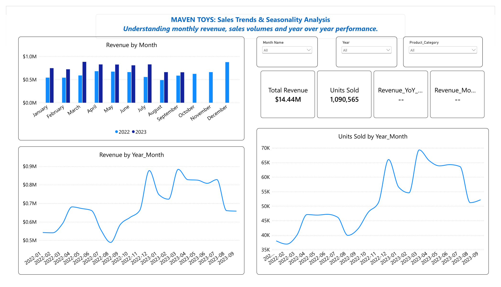
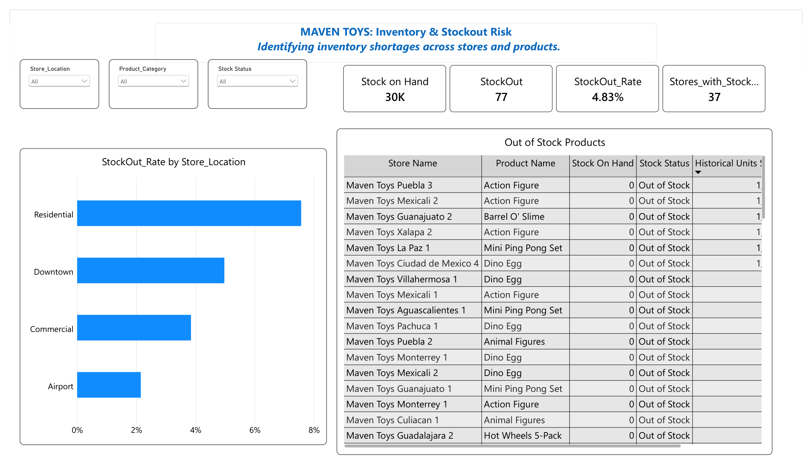
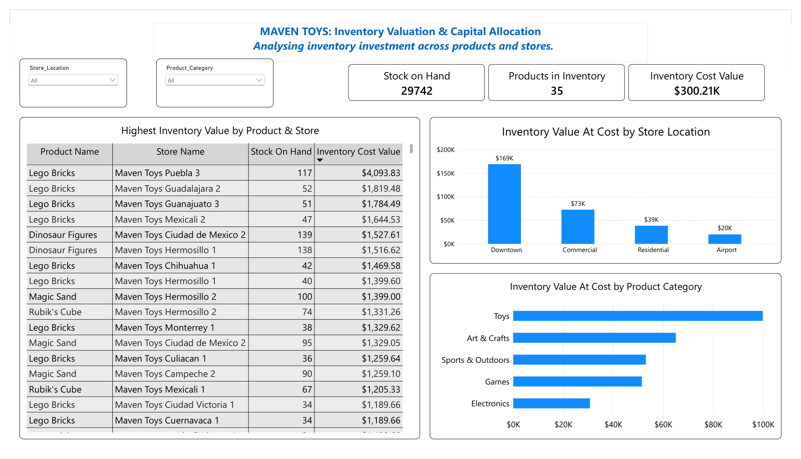

# Maven Toys | Power BI Retail Performance & Inventory Analysis

**End-to-end Power BI portfolio project** investigating profitability, sales patterns, stockout risk, and inventory investment for Maven Toys, a fictional Mexican toy retailer.

**Tools:** Power BI Desktop · Power Query · DAX · Dimensional modelling · Business intelligence  
**Source:** [Maven Analytics — Mexico Toy Sales](https://mavenanalytics.io/data-playground/mexico-toy-sales)  
**Report:** [Open the Power BI `.pbix` file](Maven.pbix) · [View the four-page PDF](Maven.pdf)

> **Scope:** 2022–September 2023 sales in this report; inventory is a **single snapshot** rather than a historical time series. The findings below are drawn from the supplied final four-page Power BI PDF. Figures marked approximately are rounded on the report visuals.

## Executive summary

| Metric | Result | Interpretation |
|---|---:|---|
| Total revenue | **$14.44M** | Revenue across the report's selected sales period |
| Estimated gross profit | **$4,014,029** | Based on listed product price less product cost, applied to units sold |
| Gross profit margin | **27.79%** | Gross profit as a percentage of revenue |
| Units sold | **1,090,565** | Total sales volume |
| Out-of-stock product–store records | **77** | **4.83%** of recorded inventory combinations |
| Stores with at least one stockout | **37 of 50** | **74%** of stores affected by one or more zero-stock records |
| Units of stock on hand | **29,742** | Inventory snapshot total |
| Inventory value at product cost | **~$300.21K** | Estimated capital invested in recorded inventory |

## Four business questions and answers

### Q1 — Which product categories drive the biggest profits? Is this the same across store locations?

**Answer:** **Toys** lead in gross profit (**$1,079,527**), while **Electronics** have the highest gross margin (**44.57%**). The leading gross-profit category varies across store-location types: Toys lead in **Downtown** and **Residential** locations, whereas Electronics lead in **Commercial** and **Airport** locations.

**Why it matters:** A category with the most profit is not necessarily the one with the strongest margin. Comparing total location-type profits is also affected by how many stores are included in each location type.



### Q2 — Can we identify seasonal sales trends and patterns?

**Answer:** The report shows monthly revenue and units-sold fluctuations from **January 2022 to September 2023**. In the monthly comparison chart, 2023 revenue appears higher than 2022 revenue for the comparable **January–September** months. The data shows peaks and dips, but its limited history is **not sufficient to establish repeatable annual seasonality conclusively**.

**Why it matters:** An apples-to-apples YoY comparison must use **January–September 2023 versus January–September 2022**, not 2023's nine months against all of 2022. The YoY/MoM cards are intentionally blank in the PDF's unfiltered view; select a relevant year or month in Power BI to examine a meaningful comparison. No numerical YoY growth claim is made here because the exported report does not present one.



### Q3 — Are stockouts causing lost sales?

**Answer:** **77** recorded product–store pairs have zero stock (**4.83%** of recorded inventory pairs), affecting **37** different stores. **Residential** stores have the highest stockout rate among the location types (~**7.57%**), followed by Downtown (~4.97%), Commercial (~3.85%) and Airport (~2.15%). The report also lists zero-stock products alongside historical sales measures to help investigate which shortages deserve attention.

**Crucial limitation:** **Actual lost sales cannot be measured from this inventory snapshot.** Zero stock alone does not reveal how long a product was unavailable or whether customers tried to buy it. The result identifies **potential sales risk**, not proven lost revenue.



### Q4 — How much money is tied up in inventory at the toy stores?

**Answer:** The report estimates **~$300.21K** invested in **29,742 units** of stock at product cost across **35 recorded product types**. **Downtown** locations hold the highest total value (**~$169K**), followed by Commercial (~$73K), Residential (~$39K) and Airport (~$20K). **Toys** hold the largest category-level inventory value (approximately **$100K** in the chart).

**Why it matters:** “Toy stores” means **all Maven Toys stores and their merchandise**, not only products labelled `Toys`. A high inventory balance alone does not imply overstocking; compare it with demand, store count, and sales performance before recommending reductions.



For detailed evidence, limitations and business recommendations: **[Four questions — full analysis](docs/business-questions.md)**.

## Data, model and calculations

The model uses a **sales fact table** and an **inventory snapshot fact table**, connected to **Products** and **Stores** dimension tables; the **Date** table supports sales time intelligence. The original dataset is available from Maven Analytics, while the cleaned data model and report are included in `Maven.pbix`.

Core calculations include:

```dax
Total_Revenue =
SUMX(
    'sales',
    'sales'[Units] * RELATED('products'[Product_Price])
)

StockOut =
CALCULATE(
    COUNTROWS('Inventory'),
    'Inventory'[Stock_On_Hand] = 0
)

StockOut_Rate =
DIVIDE([StockOut], COUNTROWS('Inventory'))

Stores_with_Stockouts =
CALCULATE(
    DISTINCTCOUNT('Inventory'[Store_ID]),
    'Inventory'[Stock_On_Hand] = 0
)

Inventory_Value_At_Cost =
SUMX(
    'Inventory',
    'Inventory'[Stock_On_Hand] * RELATED('products'[Product_Cost])
)
```

These expressions are documented from the project work; the `.pbix` remains the authoritative source for the exact final measure definitions. More explanation: **[DAX measures and methods](docs/dax-measures.md)**.

## Recommendations to management

1. **Product mix:** Evaluate Toys' high gross-profit contribution alongside Electronics' high gross margin, separately by store type.
2. **Seasonal planning:** Use matched-month YoY comparisons and monitor product categories; collect more years of data before making recurring seasonal forecasts.
3. **Replenishment:** Prioritise zero-stock product–store pairs with demonstrated historical sales; obtain stockout duration and unfulfilled-demand data before estimating lost revenue.
4. **Inventory capital:** Compare the concentration of inventory cost in Downtown locations and the Toys category against their demand and stock-turnover performance.

## Key analytical limitations

- **Stock is a snapshot**; year or month selections cannot reconstruct historical inventory positions.
- **Out of stock ≠ documented lost sale.** The report does not calculate confirmed lost sales.
- **2023 is incomplete** in this dataset, ending in September. Avoid comparing unequal year lengths as if they were full years.
- **Profit and inventory valuation are estimates:** listed product cost/price is used; operating costs, historical prices, discounts and accounting write-downs are not established from these visuals.
- **Missing inventory rows are not automatically stockouts.** A store may simply not carry a particular product.
- Monetary values shown on charts are rounded, so rounded components may not sum exactly to totals.


## Repository contents

```text
maven-toys-powerbi-analysis/
├── README.md
├── Maven.pbix
├── Maven.pdf
├── screenshots/
│   ├── 01-profitability.png
│   ├── 02-sales-trends.png
│   ├── 03-stockout-risk.png
│   └── 04-inventory-valuation.png
└── docs/
    ├── business-questions.md
    └── dax-measures.md
```

**Credits:** Original sample dataset and prompt: [Maven Analytics, *Mexico Toy Sales*] (https://mavenanalytics.io/data-playground/mexico-toy-sales). This is an independent practice portfolio analysis and not an official Maven Analytics report.
